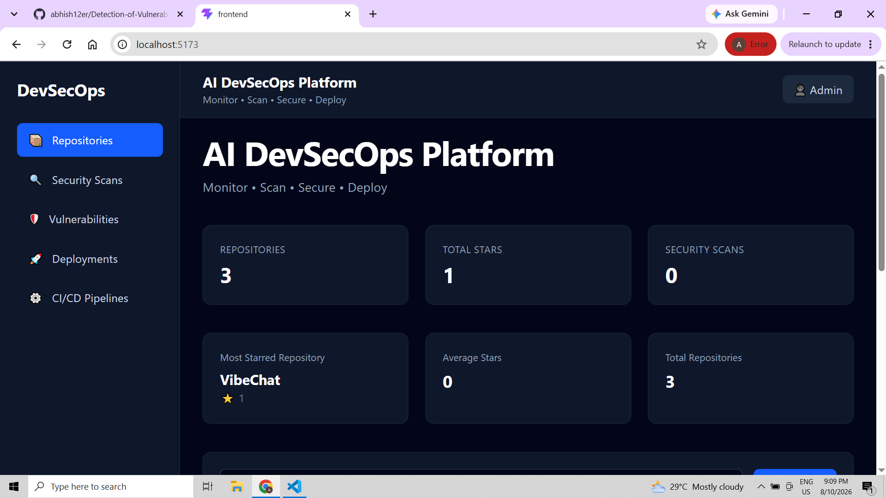
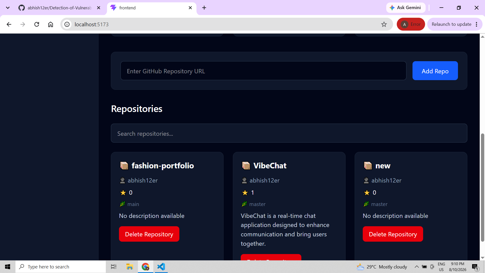
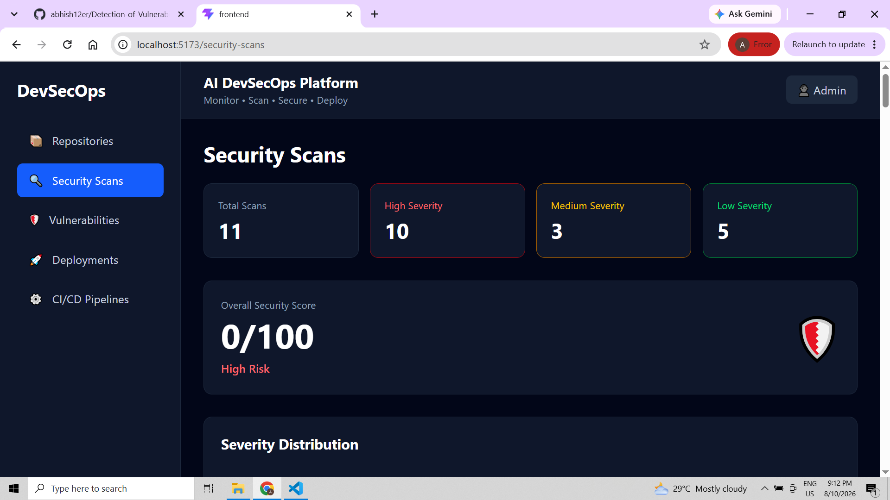
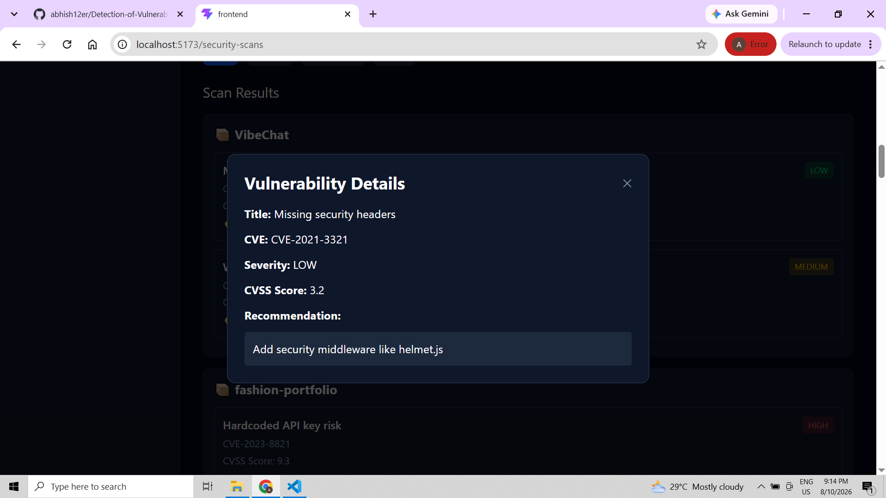
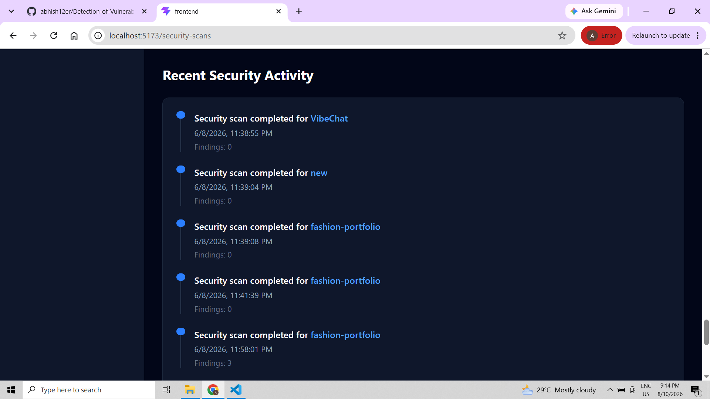
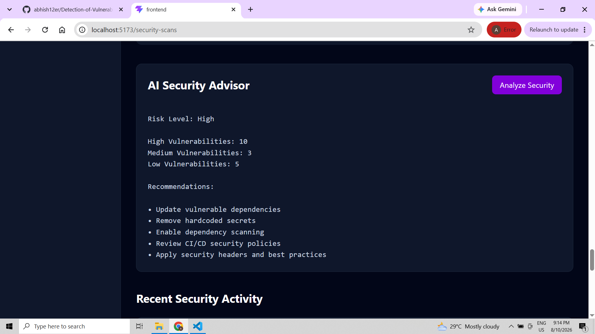
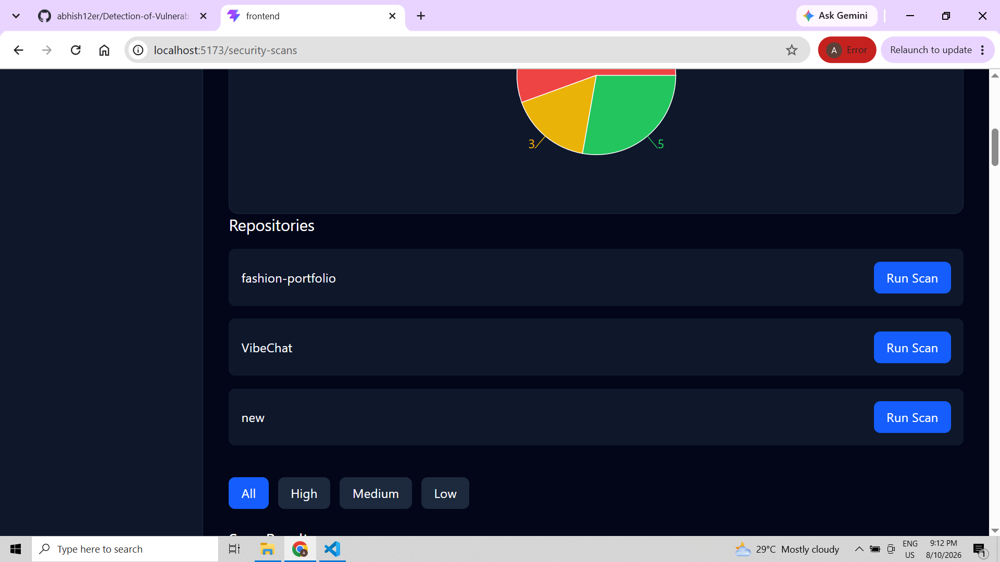

# 🛡️ AI-Powered DevSecOps Platform

> **Monitor • Scan • Analyze • Secure • Deploy**

An AI-powered DevSecOps platform that brings **repository management,
automated security scanning, vulnerability analysis, AI-assisted
security recommendations, and security activity monitoring** into a
unified dashboard.

The project is designed to demonstrate how security can be integrated
into the software development lifecycle through a centralized DevSecOps
workflow.

------------------------------------------------------------------------

## 📌 Overview

Modern development teams need security to be continuous rather than a
final step before deployment.

This platform provides a centralized workspace where developers,
security engineers, and DevOps teams can:

-   Connect and manage GitHub repositories
-   Run security scans against connected repositories
-   Detect and classify vulnerabilities
-   Review CVE and CVSS information
-   Prioritize findings by severity
-   Get AI-assisted security recommendations
-   Monitor security activity and scan history
-   Track repository security posture
-   Provide a foundation for secure CI/CD and deployment workflows

The overall objective is to transform security findings from raw
technical output into **clear, actionable security intelligence**.

------------------------------------------------------------------------

## ✨ Key Features

### 📊 Security Dashboard

The main dashboard provides a centralized overview of connected
repositories and their security posture.

It includes:

-   Total repositories
-   Total GitHub stars
-   Security scan count
-   Most-starred repository
-   Average stars
-   Overall repository statistics
-   Security activity

### 📦 Repository Management

Users can add GitHub repositories through a repository URL.

Repository information includes:

-   Repository name
-   Repository owner
-   Stars
-   Default branch
-   Description
-   Repository management actions

Repositories can also be searched and selected for security scanning.

### 🔍 Security Scanning

The Security Scans module provides visibility into repository security
assessments.

The platform tracks:

-   Total scans
-   High-severity vulnerabilities
-   Medium-severity vulnerabilities
-   Low-severity vulnerabilities
-   Overall security score
-   Risk level
-   Severity distribution
-   Repository-level scan results
-   Recent security activity

Users can run scans for individual repositories directly from the
security interface.

### 🚨 Vulnerability Detection & Analysis

Detected vulnerabilities are presented with security-relevant metadata
such as:

-   Vulnerability title
-   CVE identifier
-   Severity
-   CVSS score
-   Recommended remediation

This allows users to move through the security workflow:

**Detect → Understand → Prioritize → Remediate**

### 🤖 AI Security Advisor

The platform includes an **AI Security Advisor** designed to translate
security findings into actionable recommendations.

The advisor can present:

-   Overall risk level
-   High/medium/low vulnerability counts
-   Security recommendations
-   Dependency update recommendations
-   Hardcoded secret remediation
-   Dependency scanning recommendations
-   CI/CD security recommendations
-   Security-header recommendations

Example recommendations displayed by the platform include:

``` text
Update vulnerable dependencies
Remove hardcoded secrets
Enable dependency scanning
Review CI/CD security policies
Apply security headers and best practices
```

### 📈 Security Posture

The platform summarizes repository security using an overall security
score and risk classification.

Findings are grouped into:

-   🔴 High
-   🟡 Medium
-   🟢 Low

This helps teams quickly identify where remediation effort should be
focused.

### 📋 Security Activity

A recent activity timeline provides visibility into completed security
scans and their findings.

This creates an auditable view of security operations performed across
connected repositories.

### 🚀 Deployment & CI/CD Foundation

The platform also includes dedicated areas for:

-   Deployments
-   CI/CD Pipelines

These modules provide the foundation for integrating security checks
into automated software delivery pipelines.

------------------------------------------------------------------------

# 🖥️ Platform Screenshots

The following screenshots demonstrate the major workflows and
capabilities of the platform.

## 1. Main Dashboard

The main dashboard provides a high-level overview of repositories,
stars, security scans, and security posture.



------------------------------------------------------------------------

## 2. Repository Management

Repositories can be added using a GitHub repository URL and managed from
a centralized interface.



------------------------------------------------------------------------

## 3. Security Scans Dashboard

The Security Scans dashboard summarizes scan activity, severity
distribution, overall security score, and repository findings.



------------------------------------------------------------------------

## 4. Vulnerability Details

Individual findings can be opened to inspect vulnerability metadata such
as CVE, severity, CVSS score, and remediation recommendations.



------------------------------------------------------------------------

## 5. Recent Security Activity

The activity timeline provides a history of security scans performed
across repositories.



------------------------------------------------------------------------

## 6. AI Security Advisor

The AI Security Advisor analyzes the current security posture and
provides actionable recommendations for improving repository security.



------------------------------------------------------------------------

## 7. Repository Scan Selection

Users can select individual repositories and trigger security scans
directly from the scanning interface. Severity filters make it easier to
focus on high-priority findings.



------------------------------------------------------------------------

## 🧩 Platform Architecture

``` text
                    ┌───────────────────────┐
                    │    GitHub Repository  │
                    └───────────┬───────────┘
                                │
                                ▼
                    ┌───────────────────────┐
                    │ Repository Management │
                    └───────────┬───────────┘
                                │
                                ▼
                    ┌───────────────────────┐
                    │    Security Scanner   │
                    └───────────┬───────────┘
                                │
                ┌───────────────┼───────────────┐
                ▼               ▼               ▼
          ┌───────────┐   ┌───────────┐   ┌────────────┐
          │   SAST    │   │    SCA    │   │   Secrets  │
          │  Analysis │   │Dependency │   │ Detection  │
          └─────┬─────┘   └─────┬─────┘   └──────┬─────┘
                │               │                │
                └───────────────┼────────────────┘
                                ▼
                    ┌───────────────────────┐
                    │ Vulnerability Engine  │
                    │ CVE • CVSS • Severity │
                    └───────────┬───────────┘
                                │
                                ▼
                    ┌───────────────────────┐
                    │    AI Security        │
                    │       Advisor         │
                    └───────────┬───────────┘
                                │
                                ▼
                    ┌───────────────────────┐
                    │   Security Dashboard  │
                    └───────────┬───────────┘
                                │
                    ┌───────────┴───────────┐
                    ▼                       ▼
             ┌──────────────┐       ┌──────────────┐
             │ Remediation  │       │ Deployments  │
             │ & Monitoring │       │    / CI/CD   │
             └──────────────┘       └──────────────┘
```

------------------------------------------------------------------------

## 🔄 DevSecOps Workflow

``` text
Add Repository
      │
      ▼
Repository Discovery
      │
      ▼
Run Security Scan
      │
      ▼
Detect Vulnerabilities
      │
      ▼
Classify by Severity
      │
      ▼
CVE / CVSS Analysis
      │
      ▼
AI Security Advisor
      │
      ▼
Remediation Recommendations
      │
      ▼
Security Posture Monitoring
      │
      ▼
Secure CI/CD & Deployment
```

------------------------------------------------------------------------

## 🧩 Core Modules

  -----------------------------------------------------------------------
  Module                              Purpose
  ----------------------------------- -----------------------------------
  **Dashboard**                       Centralized overview of
                                      repositories and security posture

  **Repositories**                    Add, search, and manage GitHub
                                      repositories

  **Security Scans**                  Run and monitor repository security
                                      scans

  **Vulnerabilities**                 Review and prioritize detected
                                      security issues

  **AI Security Advisor**             Generate actionable security
                                      recommendations

  **Deployments**                     Provide deployment visibility

  **CI/CD Pipelines**                 Provide a foundation for
                                      security-aware delivery pipelines

  **Security Activity**               Track historical security
                                      operations
  -----------------------------------------------------------------------

------------------------------------------------------------------------

## 🔐 Security Concepts

### CVE

**Common Vulnerabilities and Exposures (CVE)** provides standardized
identifiers for publicly known vulnerabilities.

Example:

``` text
CVE-2021-3321
```

### CVSS

**Common Vulnerability Scoring System (CVSS)** provides a standardized
numerical score for vulnerability severity.

Example:

``` text
CVSS Score: 3.2
Severity: LOW
```

### Severity-Based Prioritization

``` text
HIGH      → Immediate attention
MEDIUM    → Planned remediation
LOW       → Review and remediate
```

------------------------------------------------------------------------

## 🤖 AI-Powered DevSecOps

The AI layer is intended to make security findings easier to understand
and act upon.

Potential AI capabilities include:

-   Intelligent vulnerability prioritization
-   Natural-language vulnerability explanations
-   Context-aware remediation recommendations
-   Security posture summarization
-   Finding correlation
-   False-positive reduction
-   Security trend analysis
-   Developer-focused remediation guidance
-   AI-generated security reports

The goal is to transform raw scanner results into **developer-friendly
security intelligence**.

------------------------------------------------------------------------

## 🛠️ Technology Stack

The exact stack should reflect the implementation in this repository.
The current application is presented as a modern web-based DevSecOps
dashboard.

### Frontend

-   React
-   Vite
-   JavaScript / TypeScript
-   Component-based UI
-   Responsive dashboard interface

### Backend / API Layer

The backend can provide APIs for:

-   Repository management
-   Security scanning
-   Vulnerability management
-   Scan history
-   AI security analysis
-   Deployment information
-   CI/CD integration

### Security Tooling

The platform can be integrated with:

-   SAST scanners
-   SCA / dependency scanners
-   Secret scanners
-   Container security scanners
-   DAST scanners
-   CVE databases
-   GitHub APIs

> Update the technology stack with the exact libraries, frameworks,
> scanners, and AI services used in your implementation.

------------------------------------------------------------------------

## 📁 Suggested Project Structure

``` text
ai-devsecops-platform/
│
├── frontend/
│   ├── src/
│   │   ├── components/
│   │   ├── pages/
│   │   ├── services/
│   │   └── ...
│   ├── public/
│   └── package.json
│
├── backend/
│   ├── routes/
│   ├── services/
│   ├── scanners/
│   └── ...
│
├── docs/
│   └── screenshots/
│       ├── 01-dashboard.png
│       ├── 02-repositories.png
│       ├── 03-security-scans.png
│       ├── 04-vulnerability-details.png
│       ├── 05-security-activity.png
│       ├── 06-ai-security-advisor.png
│       └── 07-scan-repositories.png
│
└── README.md
```

------------------------------------------------------------------------

## 🚀 Getting Started

### 1. Clone the repository

``` bash
git clone <YOUR_REPOSITORY_URL>
cd <PROJECT_DIRECTORY>
```

### 2. Install dependencies

``` bash
cd frontend
npm install
```

### 3. Start the development server

``` bash
npm run dev
```

The frontend should be available at:

``` text
http://localhost:5173
```

If the project contains a separate backend, start it using the command
specified by the backend implementation.

------------------------------------------------------------------------

## 🔄 Typical User Flow

1.  Open the DevSecOps dashboard.
2.  Add a GitHub repository.
3.  Select a repository for scanning.
4.  Run a security scan.
5.  Review detected vulnerabilities.
6.  Inspect CVE, CVSS, and severity information.
7.  Ask the AI Security Advisor for recommendations.
8.  Remediate identified security issues.
9.  Monitor security posture and scan activity.
10. Integrate security checks into CI/CD and deployment workflows.

------------------------------------------------------------------------

## 🎯 Use Cases

### 👨‍💻 Developers

-   Understand repository security issues
-   Review actionable remediation recommendations
-   Detect security issues before deployment
-   Monitor application security posture

### 🛡️ Security Teams

-   Centralize vulnerability findings
-   Prioritize high-risk vulnerabilities
-   Monitor security activity
-   Analyze repository security posture

### ⚙️ DevOps / Platform Teams

-   Integrate security into CI/CD
-   Monitor deployment security
-   Establish automated security gates
-   Track security operations

### 🎓 Security Researchers & Students

-   Learn practical DevSecOps concepts
-   Experiment with vulnerability detection
-   Understand CVE/CVSS-based prioritization
-   Explore AI-assisted security workflows

------------------------------------------------------------------------

## 📊 Security Metrics

  Metric                Description
  --------------------- -------------------------------------------
  **Total Scans**       Number of security scans performed
  **High Severity**     High-risk findings requiring priority
  **Medium Severity**   Findings requiring planned remediation
  **Low Severity**      Lower-risk security findings
  **Security Score**    Overall security posture
  **CVSS**              Standardized vulnerability severity score
  **Findings**          Issues detected during scanning
  **Scan Activity**     Historical security operations

------------------------------------------------------------------------

## 🔮 Future Enhancements

-   [ ] Real-time GitHub repository synchronization
-   [ ] Scheduled automated security scans
-   [ ] SAST integration
-   [ ] SCA / dependency vulnerability scanning
-   [ ] Secret detection
-   [ ] Container image scanning
-   [ ] DAST integration
-   [ ] AI-powered vulnerability explanations
-   [ ] AI-generated remediation suggestions
-   [ ] Automated dependency-fix pull requests
-   [ ] Security gates for CI/CD pipelines
-   [ ] Slack / email security notifications
-   [ ] Role-based access control
-   [ ] Audit logs
-   [ ] Exportable security reports
-   [ ] Vulnerability trend analytics
-   [ ] Multi-project security dashboards

------------------------------------------------------------------------

## ⚠️ Security & Responsible Use

This project is intended for **authorized security testing and defensive
security purposes**.

Only scan repositories, applications, APIs, and infrastructure that you
own or have explicit permission to test.

Do not use the platform to perform unauthorized security testing against
third-party systems.

------------------------------------------------------------------------

## 🤝 Contributing

Contributions are welcome.

1.  Fork the repository.
2.  Create a feature branch:

``` bash
git checkout -b feature/your-feature
```

3.  Commit your changes:

``` bash
git commit -m "feat: add your feature"
```

4.  Push the branch:

``` bash
git push origin feature/your-feature
```

5.  Open a Pull Request.

For security-related changes, include:

-   Description of the security problem
-   Technical implementation
-   Testing performed
-   Potential security impact
-   Configuration changes

------------------------------------------------------------------------

## 📄 License

Add the project's applicable license here.

For example:

``` text
MIT License
```

------------------------------------------------------------------------

## 👨‍💻 Author

**Abhinav Raj**

### AI-Powered DevSecOps Platform

Built to explore the integration of:

**AI + Application Security + DevSecOps + Vulnerability Management +
Secure Software Development**

------------------------------------------------------------------------

## ⭐ Project Highlights

> **AI-powered security visibility for the modern development
> lifecycle.**

**Monitor → Scan → Analyze → Remediate → Secure → Deploy**

If you find this project useful, consider giving the repository a ⭐.
